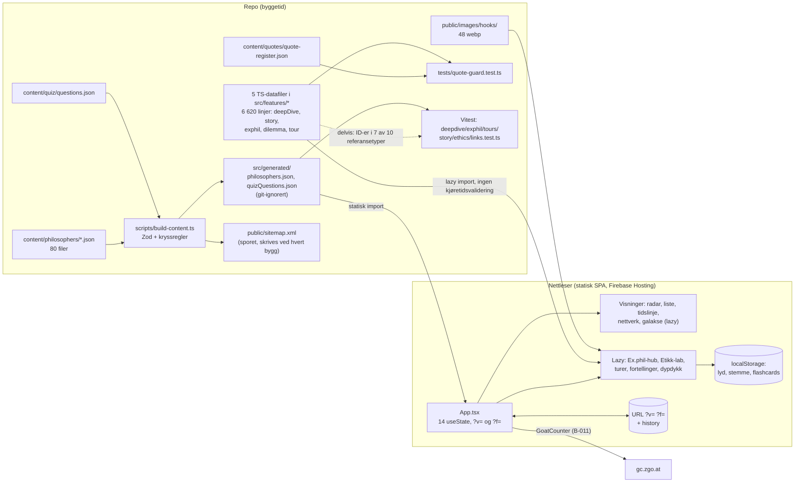
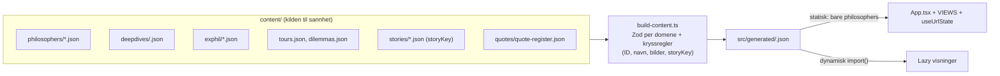

# Arkitektur og dataflyt — filosofradar

Felles regler: v2026-10-04 · Revidert: `b200444ee65e2e1f9b5aa14dab19a66c8771b94c` på `revisjon/2026-11-17-arkitektur` (fra `origin/main`) · Dato: 2026-11-17
Omfang: innholdsløypa (`content/`, `scripts/build-content.ts`, `src/schemas/`, `src/generated/`, de fem TS-datafilene) og hvordan `src/App.tsx` og visningene henter data og holder URL-tilstand · Miljø: Windows 11 Pro, Node v24.19.0, npm, Vite 8 dev-server på port 5202, Chromium (innebygd nettleser i Claude-appen) · Baseline: typecheck grønn, lint grønn, test grønn 3 av 3 kjøringer (170/170 hver gang, 24 filer), validate grønn, build grønn, budsjett grønt (133,9 kB JS gzip på første side mot 200 kB)

**Merk om «kjent fra før»:** Oppdraget sier at PR #29 er rettet («alle sitater har nå kilde»). På SHA-en over er #29 fortsatt **åpen og ikke merget** (`gh pr list`: `29 … OPEN`). Sitatregisteret har derfor 0 `sourced`, 44 `notQuotes` og 59 `unsourced`, og taket i `tests/quote-guard.test.ts:27` er 59. Sitatene er ikke vurdert på nytt i denne revisjonen.

**Antakelser for felt malen har, men oppdraget ikke fylte ut:**
- *Kritiske flyter:* valgt selv, fordi de er der innholdet i TS-filene møter `content/`: (1) innhold → bygg → app, (2) `?f=` og «åpne filosofkort» fra alle visninger, (3) filosofkort → tankeeksperiment → fortelling, (4) Etikk-lab → profil → «filosofisk tvilling», (5) Ex.phil-duell/flashcard → filosofkort.
- *Planlagte endringer de neste 6–12 månedene:* ikke oppgitt. Antatt ut fra PLAN.md, B-010 og helhetsrevisjonen: flere filosofer, rettede sitater, flere fortellinger, og en mulig flytting av TS-innholdet inn i `content/`.

**Oppfølging:** PR #29 ble merget etter at revisjonen var ferdig (`b574c40`). Sitatregisteret har nå 0 sitater uten kilde, så det som står om 59 sitater uten kilde gjelder SHA-en over, ikke `main`.

## Konklusjon

Kjernen er sunn: `content/`-løypa validerer godt, importgrafen har 0 sykler og 0 lagbrudd, og de 6 620 linjene i TS-datafilene er 96 % rene literaler (6 380 linjer data, 189 linjer logikk), så de *kan* flyttes mekanisk. Problemet er koblingene mellom de to kanalene: 16 av 381 filosof-referanser i TS-innholdet peker på en filosof som ikke finnes eller på feil person, og 3 av 32 kuraterte fortellinger nås ikke fra filosofkortet. To av feilene er bekreftet i nettleseren (ARK-01, ARK-02). Gjør først én integritetstest som fanger alle koblingene (S), før dere bestemmer om innholdet skal flyttes.

## Dekning

**Så på:**
- Hele innholdsløypa: `scripts/build-content.ts` (264 linjer), `src/schemas/` (4 filer), de genererte filene og de fem TS-datafilene (6 620 linjer, 1 + 4 + 1 + 1 + 1 eksporterte datastrukturer).
- Alle 57 moduler i `src/` i en importgraf (167 kanter).
- Alle 381 filosof-referanser, 83 bildereferanser og 52 lenker i TS-innholdet, målt med skript (vedlegg A).
- `src/App.tsx` (780 linjer, 21 endringer siden 2026-08-01) og alle steder som endrer `?v=` og `?f=`.
- 4 flyter i nettleseren mot lokal dev-server: Ex.phil-duell, Etikk-lab til slutt, Descartes-fortelling fra kortet, Hjem-knappen og Tilbake.
- 17 nb.no-lenker mot Nasjonalbibliotekets katalog-API og 13 andre lenker med lesende GET.
- `git log` for de 30 siste commitene, B-001–B-013 og begge tidligere revisjoner.

**Så ikke på, med vilje:**
- Ordlyden og kildene i sitatene (dekket av B-010 og åpen PR #29).
- Den faglige riktigheten i dypdykk, fortellinger og Ex.phil-tekstene.
- De 22 lenkene til gutenberg.org: nettstedet svarte 503 på automatiske kall, og gutendex ga tidsavbrudd (se «Ikke rukket» nederst).
- Visningskomponentenes indre logikk (radar, tidslinje, galakse) utover hvordan de får data.
- Tenant-isolasjon (metodens steg 7): appen har ingen brukere, ingen backend og ingen tenants (B-001). Ikke relevant.

## Systemet slik det er



**Avvik mot dokumentert arkitektur:**
- `docs/ARKITEKTUR.md` sitt diagram viser bare `content/philosophers` → `build-content` → `generated`. TS-datafilene, sitatregisteret og at `build-content` skriver den sporede `public/sitemap.xml`, står ikke i diagrammet. Mappestrukturen nevner `content/quotes/` og at sitemap genereres, så teksten er riktig, bare diagrammet er ufullstendig.
- `docs/DATAMODELL.md` beskriver datamodellen for filosofer, temaer og sitatregisteret, men ikke datamodellen for dypdykk, fortellinger, Ex.phil, dilemmaer eller turer. Den finnes bare som TypeScript-typer i `src/features/*/types.ts` (186 linjer til sammen).
- `CLAUDE.md:59` sier at UI-tekster samles i `src/i18n/nb.ts`. Fila finnes ikke (se åpent beslutningspunkt 2).

## Avhengighetsretning

Målt med eget TypeScript-skript (vedlegg A, `measure-deps.ts`), fordi `madge` ikke er installert:

| Mål | Resultat |
|---|---|
| Moduler / kanter i `src/` | 57 / 167 |
| Sykler (runtime-importer) | **0** |
| `lib/`, `schemas/`, `components/`, `hooks/` → `features/` | **0** |
| Kryss-feature-importer | 15, hvorav 5 bare typer og 3 dynamiske |

Den eneste kryssimporten som drar innhold, er `StoryGalleryModal.tsx:3`, som laster hele `deepDiveData` (137 876 B rå chunk) bare for å slå opp ett tankeeksperiment per fortelling (`:92-96`).

## Kritiske flyter

### Flyt 1: Innhold → bygg → app

| Ledd | Fil:linje | Hva skjer |
|---|---|---|
| Kilde | `content/philosophers/*.json`, `content/quiz/questions.json` | JSON, én fil per filosof |
| Validering | `scripts/build-content.ts:43-66` | Zod (`src/schemas/philosopher.ts:60-104`), ID = filnavn, duplikater |
| Kryssregler | `scripts/build-content.ts:83-100` | `influencedBy` finnes og er eldre |
| Avledet | `scripts/build-content.ts:110-125` | `influences` beregnes |
| Utdata | `scripts/build-content.ts:203-213`, `:215-248` | `src/generated/*.json` og `public/sitemap.xml` |
| TS-innhold | `src/features/*/…Data.ts` | **Ingen** byggetidsvalidering. TypeScript-typer + 7 testfiler |
| Bruk | `src/App.tsx:13`, `:59` | `philosophersData as Philosopher[]`, uten kjøretidsparse (riktig, siden bygget har validert) |

### Flyt 2: Åpne filosofkort (`?f=`)

| Ledd | Fil:linje | Validering |
|---|---|---|
| Fra URL | `src/App.tsx:175-180` | Hvitelistet mot filosof-ID-er |
| Fra app (alle visninger) | `src/App.tsx:199-204` (`openCard`) | **Ingen**: skriver `?f=<id>` uansett |
| Oppslag | `src/App.tsx:228-230` | `find(...) \|\| null`, kortet vises ikke ved ukjent ID |
| Telemetri | `src/App.tsx:190-197` | Sidevisning per endring i `view`/`activeCardId` |

### Flyt 3: Filosofkort → tankeeksperiment → fortelling

| Ledd | Fil:linje | Hva skjer |
|---|---|---|
| Dypdykk | `src/features/deepdive/DeepDiveSection.tsx:21` | `PHILOSOPHER_DEEP_DIVES[philosopherId]` |
| Klikk | `src/features/card/PhilosopherCard.tsx:294` | Setter `activeStoryExperiment` |
| Oppslag | `src/features/story/storyData.ts:2196-2217` | Normalisert tittel → direkte nøkkel → delstreng-treff → generert reserve |
| Galleri (annen vei inn) | `src/features/story/StoryGalleryModal.tsx:92-96` | Annen matcheregel: `toLowerCase().includes`, uten normalisering |

### Flyt 4: Etikk-lab → profil → tvilling

| Ledd | Fil:linje | Hva skjer |
|---|---|---|
| Valg | `src/features/ethics/EthicsLabView.tsx` | 6 dilemmaer, ett valg hver |
| Beregning | `src/features/ethics/dilemmaData.ts:479-558` | Summerer skoler, tvilling hardkodet i `switch` (`:516-552`) |
| Knapp | `src/features/ethics/EthicsLabView.tsx:120-125` | `onOpenPhilosopherCard(philosopherTwinId)` → `openCard` (flyt 2) |

### Flyt 5: Ex.phil → filosofkort / sammenligning

| Ledd | Fil:linje | Hva skjer |
|---|---|---|
| Duell | `src/features/exphil/ExphilDuelsView.tsx:116`, `:179`, `:259` | Kort og sammenligning med `philosopherId` fra data |
| Flashcard | `src/features/exphil/ExphilFlashcardsView.tsx:292-306` | «Åpne {philosopherName}» åpner `philosopherId` |
| Test | `tests/exphil.test.ts:120-123`, `:153` | ID-en finnes. Ikke at ID og navn hører sammen |

## Feilmodustabell

| Flyt | Ledd | Hva skjer ved feil | Håndtert | Fil:linje |
|---|---|---|---|---|
| 1 | Ugyldig filosof-JSON | Bygget stopper med feilliste | Ja | `scripts/build-content.ts:47-50`, `:102-108` |
| 1 | `influencedBy` til ukjent ID | Bygget stopper | Ja | `scripts/build-content.ts:86-88` |
| 1 | TS-innhold peker på ukjent filosof | Bygges og publiseres. ID-en sjekkes for 7 av 10 referansetyper, navnet for ingen | Delvis | ARK-01 |
| 1 | Bildesti i TS-innhold finnes ikke | Bygges og publiseres. Ingen test | Nei (0 feil i dag) | — |
| 1 | `build-content` skriver sitemap | Overskriver sporet fil ved hver `dev`/`build`; på Windows blir arbeidstreet «endret» (bare linjeslutt) | Nei | `scripts/build-content.ts:248` |
| 2 | `openCard` med ukjent ID | Ingenting skjer, URL får `?f=<ukjent>`, telemetri teller en sidevisning | Nei | `src/App.tsx:199-204` |
| 2 | Tilbake etter Hjem | Lander i en mellomtilstand brukeren aldri så | Nei | ARK-03 |
| 3 | Fortellingens nøkkel matcher ikke tittelen | Stille reserve: generert fortelling i stedet for den kuraterte | Delvis (ingen feil, men feil innhold) | ARK-02 |
| 3, 5 | Lat lasting av chunk feiler (f.eks. åpen fane under deploy) | Én `ErrorBoundary` rundt hele appen tar ned alt | Delvis | `src/main.tsx:9-11`, mistanke 1 |
| 4 | Tvilling-ID finnes ikke | Knappen gjør ingenting | Nei | ARK-01 |
| 5 | ID og navn er ulike personer | Feil filosofkort åpnes | Nei | ARK-01 |

Delvis skriving, gjentak og samtidighet er ikke relevant: appen skriver ingenting utenom `localStorage` (lyd, stemme, mestrede flashcards).

## Svar på «særlig bekymret for»

### Hvor mye av de 6 620 linjene er data, og hvor mye er logikk?

Målt statement for statement med TypeScript-kompilatoren (vedlegg A, `measure-lines.ts`):

| Fil | Linjer | Data | Logikk | Annet |
|---|---:|---:|---:|---:|
| `deepDiveData.ts` | 2 572 | 2 570 | 0 | 2 |
| `storyData.ts` | 2 318 | 2 177 | 108 (`normalizeKey`, `getStoryScript`, `getAllBespokeStories`) | 33 |
| `exphilData.ts` | 953 | 946 | 0 | 7 |
| `dilemmaData.ts` | 559 | 471 | 81 (`calculateEthicsProfile`) | 7 |
| `tourData.ts` | 218 | 216 | 0 | 2 |
| **Sum** | **6 620** | **6 380 (96,4 %)** | **189 (2,9 %)** | **51** |

- Dataene er **rene literaler**. Et AST-søk etter alt som ikke er streng, tall, boolsk verdi, objekt eller liste ga **0 treff** i alle fem filene. Det finnes 38 kommentarer inne i dataene (32 i `storyData.ts`), som ville gått tapt i JSON.
- Den lille logikken bærer selv innhold: ca. 60 av de 91 linjene i `getStoryScript` er norsk malstekst for reservefortellingen (`storyData.ts:2219-2284`), og tvillingenes tittel og beskrivelse står i `switch`-en i `calculateEthicsProfile` (`dilemmaData.ts:516-552`). Flyttes innholdet, bør disse tekstene følge med.
- Strengmengde: 1 109 strenger / 113 kB i dypdykk, 1 280 / 57 kB i fortellinger, 655 / 39 kB i Ex.phil, 298 / 13 kB i dilemmaer og 118 / 9 kB i turer.

### Bør innholdet flyttes inn i `content/`, eller valideres der det ligger?

Det er en produktbeslutning, og den står som åpent beslutningspunkt 1. Grunnlaget:

**Hva en flytting koster** (anslag ut fra målingene):

| Del | Omfang | Kostnad |
|---|---|---|
| Konvertering | `JSON.stringify` av de importerte modulene, siden alt er literaler. En test som sammenligner gammel eksport med ny JSON (`deepEqual`) beviser at ingenting endret seg | S |
| Zod-skjemaer | 5 domener, med de 186 linjene i `src/features/*/types.ts` som mal | M |
| `build-content.ts` | Lese 5 nye kilder, validere kryssreferanser (det ARK-01 og ARK-02 trenger uansett) og skrive 5 genererte filer | M |
| Brukere | 11 importer i 10 filer i `src/` og 8 testfiler. Lat lasting må beholdes (dynamisk `import()` av generert JSON) | S–M |
| `reviewed` | Felt på ca. 80 + 32 + 25 + 6 + 12 + 6 + 6 + 5 objekter, og en redaksjonell runde | L (redaksjonelt) |
| **Teknisk sum** | ca. 1,5–2 dagers arbeid, i 5–6 PR-er (én per domene) | **L** |

**Hva en flytting gir som validering på stedet ikke gir:**
- Ett sted for alle innholdsregler (`npm run validate`), og `reviewed` med advarsler som for filosofene.
- Strukturert redigering. I dag redigeres TS-kilden med regex-skript, og det har allerede gitt ødelagte linjeslutt og en 4 996-linjers diff (ARK-04).
- Én fil per dypdykk (`content/deepdives/<id>.json`) gjør «ID = filnavn» og dekningen naturlig.

**Hva validering på stedet gir billigere:** Alle koblingsfeilene i denne rapporten kan fanges av én Vitest-fil uten å flytte noe (S). TypeScript-typene holder allerede formen.

### Hvilke krysskoblinger er uvaliderte, og peker noe på noe som ikke finnes?

Målt med `measure-crossrefs.ts` (vedlegg A) mot `src/generated/philosophers.json` og `public/`:

| Kobling | Antall | Validert i dag | Peker feil |
|---|---:|---|---:|
| Dypdykk: nøkkel og `philosopherId` | 160 | Ja (`deepdive.test.ts:15-26`) | 0 |
| Fortelling: nøkkel og `philosopherId` | 64 | Nei | **2** (`foot`) |
| Ex.phil-profil: nøkkel og `philosopherId` | 50 | Ja (`exphil.test.ts:105-107`) | 0 |
| `EXPHIL_PHILOSOPHER_IDS` | 26 | Ja (`exphil.test.ts:89`) | 0, men `russell` mangler profil |
| Duell, sider | 12 | ID ja, navn nei | **1** feil person |
| Flashcard | 11 | ID ja, navn nei | **1** feil person |
| Ex.phil-quiz | 6 | Ja | 0 |
| Dilemma-reaksjoner | 25 | **Nei** | **11** (`mill` ×3, `bentham` ×3, `foot`, `singer`, `logstrup`, `hippokrates`, `jonas`) |
| Etisk tvilling (i logikk) | 5 | Bare `mill` og `kant` som navn | **1** (`mill`) |
| Turstopp | 22 | Ja (`tours.test.ts:200`) | 0 |
| **Sum filosof-referanser** | **381** | | **16** |
| Bilder (`image`, `avatar`) | 83 (48 unike) | Nei | **0** mangler, 0 foreldreløse |
| Lenker i `majorWorks` | 52 av 164 verk | Bare `https?://` (`links.test.ts:10-16`) | **1** NB-URN finnes ikke (ARK-05) |
| Fortelling ↔ tankeeksperiment | 32 fortellinger, 107 tankeeksperimenter | Nei (testen bruker fortellingens egen tittel) | **3** fortellinger nås ikke fra kortet |

Filteret er kontrollert: skriptet fant de kjente referansene til `sokrates` og `platon` og alle 48 bildefilene. Skriptet avslørte også 4 navneforskjeller, der to er ufarlige stavemåter («G.W.F. Hegel» mot «G. W. F. Hegel», «Augustin av Hippo» mot «Augustin») og to er feil person (ARK-01).

### Er ansvaret i `App.tsx` der man skulle tro?

Fordeling av de 780 linjene:

| Linjer | Ansvar |
|---|---|
| 1-62 | Importer, 9 late visninger, `ViewMode` |
| 63-231 | 14 `useState`, URL-synk, turtilstand, telemetri, `openCard`/`closeCard`/`handleGoHome` |
| 232-520 | Topplinje og tre menyer (ca. 290 linjer, 37 %) |
| 521-620 | Dagens filosof og visningsbryter |
| 621-711 | Overlegg: kort, sammenligning, turer, fortellinger |
| 712-780 | Bunntekst |

`App.tsx` er både ruter, tilstandseier og menyer. Det er forventet i en app uten ruterbibliotek. Problemet er at rutereglene ikke har ett hjem (ARK-03). Hvilke `?v=`-verdier som finnes, står 5 steder, og 3 kodestier endrer kort-tilstanden på 3 forskjellige måter. `exphilTab` ligger i `App` men ikke i URL-en. Det er kjent fra UI-revisjonen (åpent punkt «URL-ruting for undermoduler»).

### `src/i18n/nb.ts` finnes ikke. Hva er omfanget?

Målt med `measure-uitext.ts` (vedlegg A): **488 UI-strenger** (408 JSX-tekstnoder og 80 tekstattributter som `aria-label`, `title`, `placeholder` og `alt`), ca. **1 990 ord**, i **25 `.tsx`-filer**. De største er `AboutView.tsx` (56), `App.tsx` (54) og `RadarView.tsx` (44). Innholdsdataene kommer i tillegg. Nytt siden helhetsrevisjonen:
- `CLAUDE.md:59` er nå det eneste stedet regelen står. ARKITEKTUR.md nevner den ikke lenger etter #18.
- `docs/PRD.md:62-63` setter «engelsk språkversjon» utenfor MVP.

Se åpent beslutningspunkt 2.

## Funn

### [ARK-01] 16 av 381 filosof-referanser i TS-innholdet peker på en filosof som ikke finnes eller på feil person, og ingen test ser det

**Alvorlighet:** Høy · **Sikkerhet:** Bekreftet · **Merker:** —
**Hvor:**
- Etisk tvilling: `src/features/ethics/dilemmaData.ts:516-517` (`twinId = 'mill'`), brukt i `src/features/ethics/EthicsLabView.tsx:121`
- Dilemma-reaksjoner til ukjente ID-er: `src/features/ethics/dilemmaData.ts:64, 82, 110, 143, 251, 284, 312, 321, 364, 425, 462`
- Fortelling for ukjent ID: `src/features/story/storyData.ts:282-285` (`foot`)
- Feil person: `src/features/exphil/exphilData.ts:517-518` (duell «Popper vs. Kuhn», side B: `philosopherId: 'foucault'`, `philosopherName: 'Thomas Kuhn & vitenskapssosiologien'`) og `:753-754` (flashcard `fc-5`: `philosopherId: 'popper'`, `philosopherName: 'Thomas Kuhn'`)
- Vakten som slipper dem gjennom: `src/App.tsx:199-204` (`openCard` sjekker ikke ID-en, i motsetning til URL-stien på `:176`)

**Bevis:**
- `measure-crossrefs.ts` (vedlegg A): 381 referanser, 15 til 7 ID-er som ikke finnes i `content/` (`mill`, `bentham`, `foot`, `singer`, `logstrup`, `hippokrates`, `jonas`), og 2 der ID og navn er forskjellige personer. De 15 omfatter én dobbel registrering av tvillingen, altså 14 unike steder.
- Nettleser, Etikk-lab: valgte første alternativ i alle 6 dilemmaer. Resultatet var «John Stuart Mill». Klikk på «✦ Utforsk John Stuart Mill i Radaren» ga `{"before":"?v=ethics","after":"?v=ethics&f=mill","dialogs":0}`. Det åpnes ingen dialog, men URL-en endres.
- Nettleser, Ex.phil → «Popper vs. Kuhn» → «Filosofkort ↗» under overskriften «Thomas Kuhn & vitenskapssosiologien» ga `{"url":"?v=exphil&f=foucault","dialogHeading":"Michel Foucault(Michel Foucault)"}`.
- Testene sjekker at duell- og flashcard-ID-ene *finnes* (`tests/exphil.test.ts:122-123`, `:153`), og det gjør de. `tests/ethics.test.ts:45` sjekker bare at `philosopherName` er lengre enn 2 tegn.

**Hvorfor det betyr noe:**
- Konsekvensetikk er den vanligste tvillingen: den er utgangsverdien i `calculateEthicsProfile` (`dilemmaData.ts:506-513`) og vinner ved uavgjort. Hovedknappen på resultatsiden er da død.
- Ex.phil-studenter som klikker «Åpne Thomas Kuhn» eller Kuhn-sidens «Filosofkort», får Karl Popper eller Michel Foucault. Det er feil fagstoff i appens viktigste målgruppe.
- Rotårsaken er strukturell: innholdet omtaler 8 tenkere som ikke er med i radaren (Mill, Bentham, Foot, Singer, Løgstrup, Jonas, Hippokrates og Kuhn), og datamodellen har ingen måte å si «en person som ikke er en filosof i radaren» på. Derfor er det brukt stedfortredere (kommentaren på `exphilData.ts:517` viser at Foucault er valgt med vilje) og hengende ID-er.

**Forslag:**
1. `tests/content-integrity.test.ts`: alle `philosopherId` i de fem filene skal finnes i `content/`, og der `philosopherName` står, skal det være lik `name` i `content/` eller stå på en liten unntaksliste for stavemåter. Testen er rød i dag med 16 treff.
2. Gjør `philosopherId` valgfri på reaksjoner, duellsider og flashcards. Uten ID viser UI-et navnet uten «Filosofkort»-knapp. Tvillingen får en ID som finnes, eller knappen skjules.
3. `openCard` ignorerer ukjente ID-er, på samme måte som URL-stien gjør.
4. Om Mill, Kuhn og de andre skal inn i radaren, er en redaksjonell beslutning. Mill og Bentham er Ex.phil-pensum, så det er nærliggende.

**Kostnad:** S for test og vakt (under 1 t hver). M hvis personbegrepet innføres i typene og 3 komponenter.
**Ikke verifisert:** Fortellingen for `foot` er ikke kjørt i nettleser. At «Utforsk fullt dypdykk» der gjør ingenting, følger av samme `openCard`-sti (`App.tsx:704-708`). Hvor ofte konsekvensetikk faktisk blir resultatet i produksjon, er ikke målt.

### [ARK-02] Fortellinger kobles til tankeeksperimenter på tittel, og 3 av 32 kuraterte fortellinger nås aldri fra filosofkortet

**Alvorlighet:** Middels · **Sikkerhet:** Bekreftet · **Merker:** —
**Hvor:**
- Oppslaget: `src/features/story/storyData.ts:2189-2217` (normaliser tittel → direkte nøkkel → delstreng → generert reserve)
- Annen matcheregel for samme kobling: `src/features/story/StoryGalleryModal.tsx:92-96`
- Uoverensstemmelsene: `storyData.ts:78` («Det onde demon-eksperimentet») mot `deepDiveData.ts:165` («Den onde demonen (Malin génie)»); `storyData.ts:146` («Den **flyvende** mannen») mot `deepDiveData.ts:1667` («Den **flytende** mannen (Bevissthetens uavhengighet)»); `storyData.ts:282` (`foot`, finnes ikke)
- Testen som går glipp av det: `tests/story.test.ts:9-11` kaller `getStoryScript` med fortellingens *egen* tittel, ikke tittelen i dypdykket

**Bevis:**
- `measure-crossrefs.ts`: av 107 tankeeksperimenter får 29 en kuratert fortelling og 78 den genererte reserven. 3 av 32 kuraterte fortellinger nås ikke fra noe tankeeksperiment.
- Nettleser, `?f=descartes` → «▶ Se idéen på 45 sek» ved «Den onde demonen»: dialogen viser «Et berømt tankeeksperiment fra René Descartes», som er undertittelen i reserven (`storyData.ts:2235`), og ikke den kuraterte fortellingen.
- Galleriet åpner de samme fortellingene riktig, fordi det bygger et syntetisk tankeeksperiment med fortellingens egen tittel (`StoryGalleryModal.tsx:97-103`). Samme fortelling oppfører seg altså forskjellig etter hvor man kommer fra.

**Hvorfor det betyr noe:** Descartes' demon er Ex.phil-pensum. Kuratert innhold som er skrevet og testet, vises ikke der brukeren mest sannsynlig leter. Koblingen er usynlig: den som retter en skrivefeil i en tankeeksperiment-tittel, bryter fortellingen uten at noe blir rødt. «Flyvende/flytende» ser ut til å være nettopp det.

**Forslag:** Gjør koblingen eksplisitt. Gi `ThoughtExperiment` et valgfritt `storyKey` (`src/features/deepdive/types.ts:9-15`), slå opp direkte og fjern delstreng-treffet. La galleriet bruke samme funksjon. Integritetstesten (ARK-01) sjekker at hver `storyKey` finnes og at hver kuratert fortelling har nøyaktig ett tankeeksperiment eller står på en liste over fortellinger som bare finnes i galleriet.
**Kostnad:** S. 29 + 2 nøkler settes i dataene, ca. 20 linjer kode og én test.
**Ikke verifisert:** Ibn Sina er ikke kjørt i nettleser, bare målt.

### [ARK-03] URL- og visningstilstand har ingen eier: visningslisten står 5 steder, og Hjem lager to historikkoppføringer

**Alvorlighet:** Middels · **Sikkerhet:** Bekreftet · **Merker:** —
**Hvor:**
- Visningslisten: `src/App.tsx:61` (`ViewMode`), `:153-164` (`validViews`), og «observatorie-visninger» tre ganger på `:79-80`, `:85` og `:167`. I tillegg kommer sitemap-listen i `scripts/build-content.ts:186-195`.
- Doble `pushState`: `src/App.tsx:214-224` (`handleGoHome` kaller `changeView('radar', true)`, som pusher, og pusher så én gang til), `:580-584` og `:593-597` (`changeView` + `openCard` = 2 pusher)
- Kort-tilstand uten URL: `src/App.tsx:526-529` (`setActiveCardId(null)` uten å fjerne `?f=`)

**Bevis:** Nettleser fra `?v=about&f=sokrates`, klikk på Hjem: `history.length` 6 → 8, URL `""`. Én gang Tilbake ga `?f=sokrates` med filosofkortet åpent over radaren. Den tilstanden har brukeren aldri sett.
**Hvorfor det betyr noe:**
- Tilbake-knappen, også mobilens tilbake-gest, oppfører seg uventet etter Hjem og etter «vis på radaren» fra Ex.phil og quizen.
- En ny visning krever 5 synkrone endringer. En glemt endring gir en visning som virker ved klikk, men ikke fra en delt lenke.

**Forslag:**
- Én `VIEWS`-konstant med `{ id, group: 'observatory' | 'exphil' | 'experience' | 'info', inSitemap }`. Typen, hvitelisten, gruppesjekkene og sitemap avledes fra den.
- Én `navigate({ v, f }, { push })` som gjør én `pushState` per brukerhandling. Den kan ligge i en liten `useUrlState`-hook i `src/hooks/`.
- Test: Hjem gir `history.length + 1`.

**Kostnad:** M. Endringen er liten, men berører mange kall i `App.tsx`. Komponenttesten bruker oppsettet fra B-009.
**Ikke verifisert:** Telemetri-effekten ved doble pusher (om GoatCounter teller mellomtilstanden) er ikke målt.

### [ARK-04] `deepDiveData.ts` er redigert med regex-skript og har fått ødelagte linjeslutt, så git behandler fila som ikke-tekst

**Alvorlighet:** Lav · **Sikkerhet:** Bekreftet · **Merker:** —
**Hvor:** `src/features/deepdive/deepDiveData.ts` (61 linjer slutter på `\r\r\n` og følges av en linje med bare mellomrom, f.eks. `:16-17`), og skriptet som redigerer fila: `scripts/apply_verified_links.cjs:4-8`
**Bevis:**
- `git ls-files --eol`: `i/-text w/-text` for `deepDiveData.ts`, mot `i/lf` for de fire andre datafilene.
- Bytetelling i indeksen: 2 416 CRLF og 2 572 LF.
- `od -c` på `:16`: `.   '   ,  \r  \r  \n` etterfulgt av `\n` med bare mellomrom.
- `git show --stat 751e226` («fix(links) …»): `deepDiveData.ts | 4996 +++---` for en lenkeretting i en fil på 2 572 linjer.

**Hvorfor det betyr noe:** Git normaliserer ikke linjeslutt i fila, og neste lenke- eller sitatretting via skript kan igjen gi en diff på hele fila. Da kan den ikke reviewes, og B-010 forutsetter nettopp at sitatrettinger reviewes én og én. Det er et konkret eksempel på hva strukturert redigering (JSON) ville spart.
**Forslag:** Normaliser linjeslutt i én egen commit (`.gitattributes` med `* text=auto eol=lf`, deretter `git add --renormalize .`). Bruk `JSON.parse`/`stringify` eller AST-redigering i stedet for regex i skriptene.
**Kostnad:** S.
**Ikke verifisert:** Om noen editor viser de 61 tomme linjene ekstra, er ikke prøvd.

### [ARK-05] NB-lenken til Kants «Grunnlegging av moralens metafysikk» peker på en post som ikke finnes

**Alvorlighet:** Lav · **Sikkerhet:** Bekreftet · **Merker:** —
**Hvor:** `src/features/deepdive/deepDiveData.ts:327`, med opphav i `scripts/verified_links_catalog.cjs:80-83`
**Bevis:**
- `GET https://api.nb.no/catalog/v1/items/URN:NBN:no-nb_digibok_2014061808064` → **404**. Kontrollen `…_2008111800096` (Platon, `deepDiveData.ts`) → **200**.
- Katalogsøk på URN-en ga 0 treff, mens et søk på tittelen ga 507 treff.
- De øvrige 13 URN-lenkene ga treff med tittel som stemmer (vedlegg B).

**Hvorfor det betyr noe:** Lenken står i en katalog som heter «verified», og historikken har hallusinerte URN-er (`751e226`). `tests/links.test.ts` sjekker bare formatet.
**Forslag:** Bytt til en URN som finnes. Legg et valgfritt skript `npm run sjekk-lenker` (ikke i CI, for ikke å gjøre testene nettavhengige) som slår opp NB-URN-er i katalog-API-et.
**Kostnad:** S.
**Ikke verifisert:** Om URN-en er fjernet fra NB eller aldri har eksistert. De 22 Gutenberg-lenkene er ikke kontrollert.

### [ARK-06] Tall som følger av innholdet er hardkodet 8 steder, og 2 av dem er allerede feil

**Alvorlighet:** Lav · **Sikkerhet:** Bekreftet · **Merker:** —
**Hvor:**
- «32» fortellinger: `src/App.tsx:499`, `:501`, `:733`
- «6 moralske prøvelser»: `src/features/ethics/EthicsLabView.tsx:83`
- «Alle tradisjoner (80)»: `src/features/galaxy/Galaxy3DView.tsx:521`
- Tester: `tests/deepdive.test.ts:12`, `tests/fase9-wow.test.ts:34`, `:69` (`toBe(80)`)
- Allerede feil (bare kommentarer): `src/App.tsx:682` («31»), `src/features/story/storyData.ts:5` («15 Kuraterte»)

**Bevis:** I dag er det 32 kuraterte fortellinger og 6 dilemmaer (målt), og 80 filosofer (bygget).
**Hvorfor det betyr noe:** Den 81. filosofen gjør 3 tester røde av en grunn som ikke er en feil. Den 33. fortellingen gir feil tall i menyen.
**Forslag:** Avled tallene (`BESPOKE_STORIES`-lengden er tilgjengelig der menyen tegnes, eller send den inn som prop). Testene sammenligner mengder (`keys(DEEP_DIVES)` = `ids(philosophers)`) i stedet for 80.
**Kostnad:** S.
**Ikke verifisert:** —

## Mistanker som bør undersøkes

1. **En feilet lat chunk tar ned hele appen.** *Sannsynlig, Lav.* Det finnes bare én `ErrorBoundary` (`src/main.tsx:9-11`), og den ligger rundt hele `App`. Firebase Hosting erstatter alle filer ved deploy. En fane som var åpen før en deploy og så åpner Ex.phil eller et dypdykk, vil derfor be om en chunk-hash som ikke finnes lenger, og få hele appen erstattet av reservesiden. Ikke prøvd mot Firebase.
2. **Ny klone: `npm run check` og `npm test` feiler før `build-content` er kjørt.** *Sannsynlig, Lav.* `src/generated/` er git-ignorert, og `App.tsx:13` samt 12 testfiler importerer den. CI kjører `build-content` først (`.github/workflows/ci.yml:32-33`), men CLAUDE.md beskriver `npm run check` som selvstendig. Ikke kjørt i en ren klone.
3. **`build-content` skriver den sporede `public/sitemap.xml` ved hver `dev` og `build`.** *Bekreftet, Lav.* `git status` viser ` M public/sitemap.xml` etter én kjøring, med bare linjeslutt som forskjell (LF skrevet, CRLF i arbeidstreet). Det er støy for en nybegynner som skal committe.
4. **Russell står som Ex.phil-pensum uten Ex.phil-profil.** *Bekreftet, Lav.* `russell` er i `exphilIds.ts`, men ikke i `EXPHIL_PROFILES`. Kortet viser da ingen eksamensboks (`ExphilCardExamBox.tsx:17-19`), og huben viser `themeNotes` i stedet for kjernepoeng (`ExphilHub.tsx:134-153`). Det håndteres pent, men det er et innholdshull. Integritetstesten bør kreve at mengdene er like, eller loggføre unntaket.
5. **Galleriet laster hele dypdykk-chunken (137 876 B rå) for å finne ett tankeeksperiment.** *Bekreftet, Lav.* `StoryGalleryModal.tsx:3`, `:92`. Løses gratis av `storyKey` i ARK-02, siden fortellingen da kan bære det den trenger.

## Strøkne funn

1. **«Platon: Symposion og Faidon peker på samme NB-post, så den ene lenken er feil.»** Avkreftet: NB-katalogen gir «Samlede verker. B. 4 : Faidon ; Symposion (Drikkegildet i Athen) ; Faidros» for URN-en. Det er samme bind.
2. **«Innholdsdataene ligger i hovedbunten.»** Avkreftet for denne SHA-en, rettet i #14: `deepDiveData`, `storyData` og `exphilData` er egne chunker (137 876 / 83 718 / 49 651 B rå), og budsjettet er grønt (133,9 kB).
3. **ARK-01 som «med vilje» (Foucault som stedfortreder for Kuhn).** Vurdert. Kommentaren på `exphilData.ts:517` viser at valget var bevisst, men knappen lover Kuhn og åpner Foucault. Det står ingen B-beslutning bak. Funnet står, og forslaget gir en ærlig måte å gjøre det samme på.
4. **ARK-01 som Latent.** Vurdert. Etikk-lab ligger i menyen («Opplevelser & Quiz»), og flyten ble kjørt helt fram til den døde knappen på dev-server bygget fra SHA-en. Produksjonen bygges fra `main` (helhetsrevisjonen bekreftet samme hash). Funnet står.

## Det som er bra og bør bevares

1. **`content/`-løypa:** Zod med kryssregler, ID = filnavn og et bygg som stopper. Den er malen for resten av innholdet.
2. **Ren lagdeling:** 0 sykler og 0 importer fra `lib/`, `schemas/`, `components/` eller `hooks/` opp i `features/`. ID-konstantene er skilt fra Zod og innhold (`src/schemas/ids.ts`, `exphilIds.ts`), så forsiden slipper å laste innhold.
3. **Innholdet er rene literaler** (0 beregnede uttrykk). Det gjør en eventuell flytting mekanisk og bevisbar med `deepEqual`. Hold det slik, og ikke legg funksjoner eller utregninger inn i datafilene.
4. **Hvitelisten på `?v=` og `?f=`** (`App.tsx:153-180`). Den er riktig, og bør bli den eneste veien inn.
5. **Sitatvakten** (B-010) som en liste som bare kan krympe. Det mønsteret passer også for integritetstesten i ARK-01, mens dataene rettes.

## Lette etter, fant ikke

- **Bildestier som ikke finnes:** 83 referanser (48 unike) i dypdykk, fortellinger og dilemmaer → 0 mangler, og 0 av 48 filer i `public/images/hooks/` er ubrukte (`measure-crossrefs.ts`).
- **Filosofer uten dypdykk:** 80 av 80 har dypdykk.
- **Nøkkel ≠ `philosopherId` i Record-dataene:** 0 i dypdykk og Ex.phil-profiler. Alle 32 fortellingsnøkler er lik `philosopherId:normalisert tittel`.
- **Avledede felt i fortellinger som har glidd fra hverandre:** `totalDurationSeconds` = summen av lysbildene i 32 av 32. `chapterNumber` = posisjon i 128 av 128.
- **Lenker uten HTTPS:** 0 av 52.
- **Importsykler:** 0 (se Avhengighetsretning).
- **Portretter fra Commons:** 0 av 80 filosofer har `image`, så ingen bildelisens å validere i `content/`.

## Åpne beslutningspunkter

### Åpent beslutningspunkt: Skal TS-innholdet flyttes inn i `content/`?
Klassifisering: prosjektintern.
Innstilling: **ja, men i to trinn, og ikke før integritetstesten finnes.**
1. Først integritetstesten (ARK-01, ARK-02) der dataene ligger i dag. Den er billig, fanger alt denne revisjonen målte, og er like nyttig etter en flytting.
2. Deretter flytting domene for domene, minst først: turer (216 linjer) som pilot, så Ex.phil, dilemmaer, dypdykk (én fil per filosof) og til slutt fortellinger. Hvert steg har en `deepEqual`-test mot den gamle eksporten.

Innstillingen hviler på at dataene er 96 % rene literaler (flyttingen er mekanisk), at regex-redigering allerede har skadet én fil (ARK-04), og at B-010 kaller flytting «riktig på sikt». Kostnaden er ca. L teknisk, se tabellen over. `reviewed` på TS-innhold er et redaksjonelt valg Eirik bør ta samtidig. Uten det blir 6 380 linjer stående uten gjennomlesningsflagg, mens filosofene har det.

### Åpent beslutningspunkt: Regelen om `src/i18n/nb.ts`
Klassifisering: prosjektintern.
Innstilling: **stryk regelen i `CLAUDE.md` og erstatt den med en mindre: «Gjentatte UI-tekster og tekster med tall som følger av innholdet samles i `src/i18n/nb.ts`».** Det hviler på:
- Det er 488 strenger i 25 filer, og flytting av alt er M–L uten gevinst for brukeren.
- Engelsk er utenfor MVP (`docs/PRD.md:62-63`).
- Prosjektet er et læreprosjekt der Olai skal finne teksten der han ser den.
- Det som faktisk har glidd, er gjentatte tall og tekster (ARK-06). De får et hjem med den smale regelen.

Alternativet er å beholde regelen og flytte gradvis per fil, men da står regelen brutt i lang tid, og neste revisjon flagger den igjen.

### Åpent beslutningspunkt: Personer som omtales, men ikke er filosofer i radaren
Klassifisering: prosjektintern (redaksjonell).
Innstilling: legg Mill og Bentham inn som filosofer, siden de er Ex.phil-pensum og er tvilling og reaksjon 6 ganger. De andre (Foot, Singer, Løgstrup, Jonas, Hippokrates, Kuhn) vises som navn uten «Filosofkort»-knapp til dere eventuelt tar dem inn. Det hviler på ARK-01 og på at listen over filosofer er en redaksjonell beslutning (`docs/INNHOLD.md`).

## Forslag til endringsordrer

Ingen av ordrene er i fredet klasse.

1. **PR `test/innholdsintegritet`** (ARK-01 og ARK-02, del 1): `tests/content-integrity.test.ts` med ID-, navn-, bilde-, fortelling- og Ex.phil-mengdesjekk, og en unntaksliste som bare kan krympe (som sitatvakten). `openCard` ignorerer ukjente ID-er. Ca. 150 linjer.
2. **PR `fix/fortelling-kobling`** (ARK-02): `storyKey` på `ThoughtExperiment`, én oppslagsfunksjon for kort og galleri, og test med dypdykkets egne titler. Ca. 100 linjer.
3. **PR `fix/personer-utenfor-radaren`** (ARK-01, del 2, etter beslutningspunkt 3): valgfri `philosopherId`, tvillingknappen skjules eller peker riktig, Kuhn-duellen og `fc-5` får ærlig merking. Krymper unntakslisten fra PR 1. Ca. 100–200 linjer.
4. **PR `refactor/visninger-og-url`** (ARK-03): `VIEWS`-konstant, én `navigate`, sitemap avledet, og komponenttest for Hjem og Tilbake. Ca. 200 linjer.
5. **PR `chore/linjeslutt`** (ARK-04): `.gitattributes` og renormalisering i én commit uten andre endringer. Diffen blir stor, men er bare linjeslutt.
6. **PR `fix/kant-urn-og-tall`** (ARK-05, ARK-06): ny URN, avledede tall og mengdetester. Ca. 60 linjer.
7. **Etter beslutningspunkt 1:** flytting til `content/` domene for domene, én PR per domene. Hver flytte-PR er stor i linjer, men mekanisk og bevist med `deepEqual`.

## Endringsscenarier

| Scenario | Filer som må røres | Lag som krysses |
|---|---|---|
| Legg til Thomas Kuhn (som dataene allerede omtaler) | 8: `content/philosophers/kuhn.json`, `deepDiveData.ts` (testen krever dypdykk), `tests/deepdive.test.ts:12`, `tests/fase9-wow.test.ts:34,69`, `Galaxy3DView.tsx:521`, `exphilData.ts:517,753`, ev. `exphilIds.ts`, ev. `quote-register.json` | content, TS-innhold, UI, tester |
| Ny kuratert fortelling | 4–5: `storyData.ts` (nøkkelen må stemme tegn for tegn med dypdykkets tittel), `App.tsx` ×3 («32»), `StoryGalleryModal.tsx:20-41` (håndskrevne epokelister), bilde i `public/images/hooks/`, ev. `tests/story.test.ts` | TS-innhold, UI, statiske filer |
| Ny visning `?v=…` | 2 filer, 6 steder: `App.tsx:61`, `:79-80`, `:85`, `:153-164`, `:167`, menyen, og `build-content.ts:186-195` | app, byggeskript |
| Rette skrivefeil i en tankeeksperiment-tittel | 1 fil hvis man vet om koblingen, ellers brytes fortellingen stille: `deepDiveData.ts`, + `storyData.ts`-nøkkelen, + `quote-register.json` hvis tittelen har «…» | TS-innhold |

Etter forslag 1–4 blir scenario 2 til 2 filer, scenario 3 til 1 sted, og scenario 4 til rødt i test i stedet for stille brudd.

## Målbilde



Rekkefølge, der hvert steg etterlater en fungerende app og har en test som viser at atferden er uendret:
1. Integritetstest med unntaksliste (rød for nye feil, grønn for kjente). Atferd uendret.
2. `storyKey` og én oppslagsfunksjon. Test: alle 32 kuraterte fortellinger nås fra kortet, eller står på galleri-listen.
3. `VIEWS` og `navigate`. Test: Hjem gir én historikkoppføring, og hver `?v=` i sitemap virker.
4. Per domene: konverter til JSON, flytt valideringen fra testen inn i `build-content`, og bytt import. Test: `deepEqual(gammelEksport, generertJson)` i samme PR, fjernet i neste.

## Anbefalt neste revisjon

1. **07 — Testbarhet og kanttilfeller**, omfang `tests/` og flytene i denne rapporten. Lim inn i «Særlig bekymret for»:
   - Hvilke tester tester sin egen kopi av dataene i stedet for koblingen (som `story.test.ts:9-11`)?
   - Fanger integritetstesten fra ARK-01 det den skal, hvis man snur én referanse om gangen?
   - Hvordan testes Tilbake-knappen og `?v=`/`?f=` i jsdom?
2. **03 — Kodekvalitet** på `RadarView.tsx` (1 345 linjer) og `App.tsx` *etter* ARK-03, slik at refaktoreringen av menyene bygger på `VIEWS`.

## Ikke rukket

- **Gutenberg-lenkene (22 av 52):** `gutenberg.org` svarte 503 på automatiske kall, og alle 22 oppslag via gutendex fikk tidsavbrudd.
- **`foot`-fortellingen og Ibn Sina i nettleser:** bare målt med skript.
- **Ren klone (mistanke 2) og chunk-feil etter deploy (mistanke 1):** ikke prøvd.

## Vedlegg A — målekommandoer

Skriptene ligger utenfor repoet, i oppdragsgiverens scratchpad, og ble kjørt fra arbeidstreet med `npx tsx`. De er ikke committet. Hovedgrepene:

- `measure-lines.ts`: leser hver datafil med `ts.createSourceFile`, fjerner `\r`, og klassifiserer hvert toppnivå-statement. `VariableStatement` med objekt- eller liste-literal regnes som data, funksjoner som logikk. Linjer telles fra start til slutt per statement.
- `measure-crossrefs.ts`: importerer de fem modulene og `src/generated/philosophers.json` og samler alle `philosopherId`, Record-nøkler, `philosopherName`, `image`/`avatar` og `majorWorks[].url`. Tvillingene hentes ved å kjøre `calculateEthicsProfile` med valg som maksimerer hver skole. Fortellingskoblingen kjøres gjennom ekte `getStoryScript` for alle 107 tankeeksperimenter. Galleriets matcheregel er kopiert fra `StoryGalleryModal.tsx:93-96`.
- `measure-deps.ts`: importgraf over `src/` med Tarjan for sykler (type-importer utelatt) og lister over kryss-feature-importer og importer oppover i lagene.
- `measure-uitext.ts`: teller `JsxText` med minst ett ord og attributtene `aria-label`, `title`, `placeholder`, `alt` og `label` i alle `.tsx`/`.ts` under `src/`.
- AST-søk etter ikke-literaler i dataene: alle noder i initialiseringene som ikke er streng, tall, boolsk verdi, objekt, liste, egenskapsnavn eller `new Set` → 0 i alle fem filer.

Andre kommandoer:
```bash
npm run check                          # grønn; 170/170
npx vitest run (×2 til)                # 170/170, 170/170
npm run build && npm run budget        # 133,9 kB JS (budsjett 200 kB)
git ls-files --eol src/features/*/*Data.ts
git show --stat 751e226 -- src/features/deepdive/deepDiveData.ts
curl https://api.nb.no/catalog/v1/items/<URN>      # 404 for Kant, 200 for kontroll
```

## Vedlegg B — NB-lenker

13 av 14 URN-lenker ga en katalogpost med samme verk (bl.a. «Sokrates' forsvarstale», «Samlede verker. B. 5 : Kleitofon ; Staten», «Den nikomakiske etikk», «Meditasjoner over filosofiens grunnlag», «Til meg selv», «Om det tragiske», «Jordens fordømte»). Epiktets lenke gir «Handbok i moral», en annen tittel på Encheiridion. 1 URN ga 404 (ARK-05). 3 av de 17 nb.no-lenkene er søke-URL-er og ble ikke slått opp. De 13 lenkene utenfor nb.no og gutenberg.org (classics.mit.edu, marxists.org, newadvent.org, wikisource, ctext.org og earlymoderntexts.com) svarte 200. Tittelen stemte der siden har verkstittelen i `<title>`; ctext.org og earlymoderntexts.com har det ikke. De 22 Gutenberg-lenkene ga 503 direkte og tidsavbrudd via gutendex, og er ikke kontrollert.
